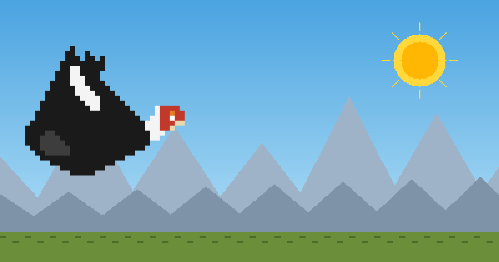
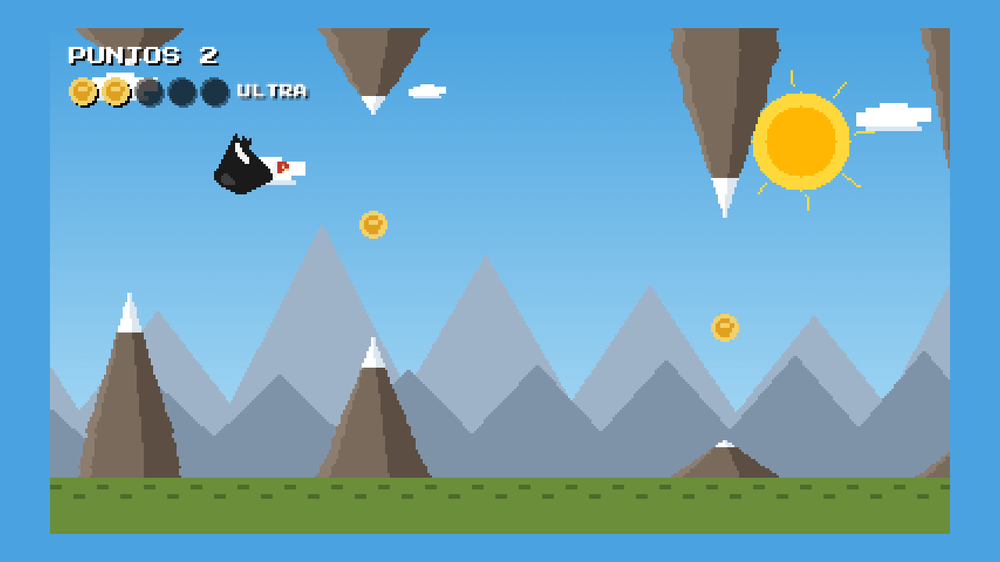
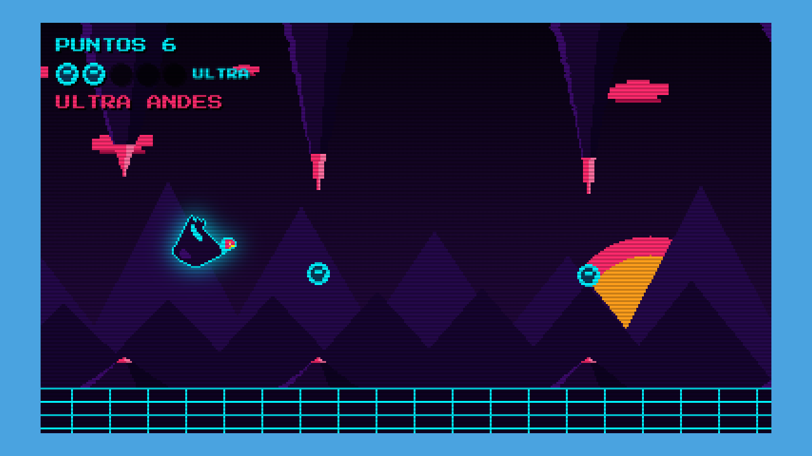
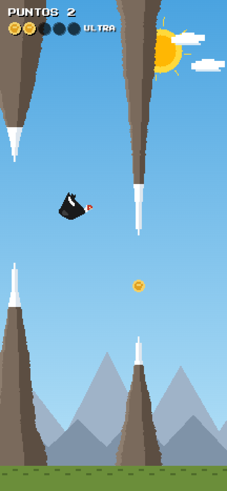
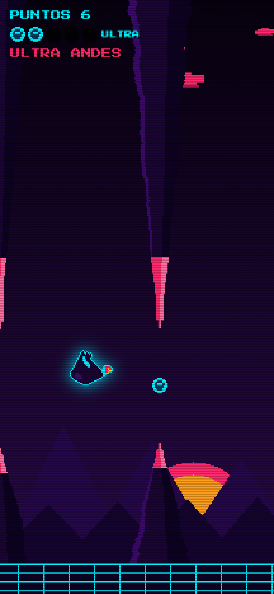
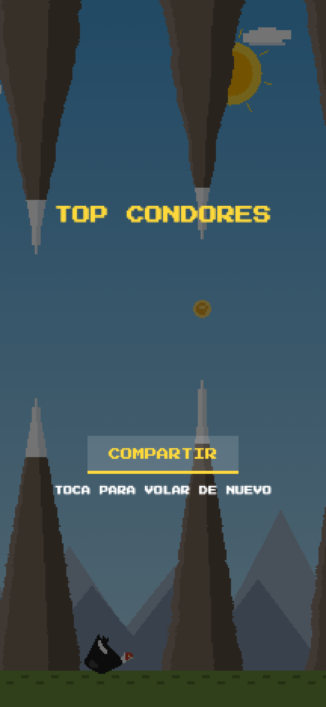

<p align="center">
  <a href="https://condor-andes.pages.dev"></a>
</p>

<h1 align="center">Cóndor de los Andes</h1>

<p align="center">
  Flappy-style pixel game for <a href="https://hacktheandes.com">Hack the Andes</a> (Lima). Fly the condor, grab 5 Inti coins, enter <b>ULTRA ANDES</b>.<br>
  Juego pixel art estilo Flappy para Hack the Andes. Vuela el cóndor, junta 5 monedas, entra al <b>ULTRA ANDES</b>.
</p>

<p align="center">
  <a href="https://condor-andes.pages.dev"><b>▶ PLAY / JUGAR → condor-andes.pages.dev</b></a>
</p>

<p align="center">
  
  
  
  
</p>

---

## How to play · Cómo se juega

| | |
|---|---|
| **Flap** | Tap anywhere · Space · ↑ |
| **Score** | +1 per mountain pair you pass |
| **Coins** | Every gap has an Inti coin. Collect **5** → **ULTRA ANDES**: cyberpunk Andes, glowing condor, **x2 points** |
| **ULTRA rules** | Hit a mountain in ULTRA → back to normal (1 s invulnerable). Hit a mountain or the ground in normal → game over |
| **Leaderboard** | 3-letter arcade name → global **TOP CONDORES** (top 10). Share your score with one tap |

<p align="center">
  
  
</p>
<p align="center">
  
  
  
</p>

## Features

- **Pixel art drawn in code** — every sprite is a letter-coded string (`sprites.js`); ULTRA mode is the same art with a palette swap + glow + scanlines.
- **Procedural Andes** — mountain pairs with random height, width, gap and spacing; difficulty ramps after the first three.
- **Phone-first** — portrait uses a tall 216-px-wide playfield that fills the screen; desktop is a crisp integer-scaled 384×216. Tap anywhere.
- **Global leaderboard** — one Cloudflare Pages Function over a single KV key. Name sanitised, score plausibility-capped.
- **Shareable** — Open Graph cover, favicon and app icon generated from the game's own sprites (`cover.html`).
- **Zero runtime dependencies** — three ES modules on one `<canvas>`, copied into a minimal allowlisted deployment bundle.

## Project layout

```
index.html              canvas, meta tags, safe-area CSS
game.js                 fixed-step loop, physics, procedural mountains, modes, screens, input
sprites.js              pixel sprites (condor glide/flap, coin) + normal/ULTRA palettes + theme colours
functions/api/scores.js GET/POST /api/scores  (Cloudflare Pages Function, KV binding SCORES)
cover.html              renders og.png / logo.png / icons from the sprites
scripts/make-cover.sh   headless-Chrome runner for cover.html
scripts/build.mjs       copies only public runtime assets into dist/
_headers                Cloudflare Pages browser security headers
docs/                   design spec, implementation plan, screenshots
```

## Development

```sh
npm test                  # unit checks (node --test): sprites + leaderboard logic
npm run build             # create the allowlisted static deployment in dist/
npm run dev               # Cloudflare Pages dev server with local KV → http://localhost:8788
npm run deploy            # wrangler pages deploy
sh scripts/make-cover.sh  # regenerate og.png, logo.png, favicon.png, apple-touch-icon.png (needs Chrome)
```

On a loopback development host (`localhost`, `127.0.0.1`, or `::1`), open the game with `#debug` in the URL to get `window.condor` (state, mode, score, `startPlay()`, `enterUltra()`, `gameOver()`) for automation. Production hosts never expose this hook.

**Leaderboard** lives in KV (`SCORES` binding, key `top`). Reset production:

```sh
npx wrangler@latest kv key delete --namespace-id 37bf007b13074d738e15826d3802da64 top --remote
```

## API

| Method | Path | Body | Response |
|---|---|---|---|
| `GET` | `/api/scores` | — | top 10 `[{ name, score }]` |
| `POST` | `/api/scores` | `{ name, score }` — name → `A-Z0-9`, 1–3 chars; score integer 1–2000 | new top 10 |

## How it was built

Designed and shipped in one day with [Claude Code](https://claude.com/claude-code): sprites and palettes were brainstormed visually first, then a spec → plan → code loop, then a role-based agent team (Product with the final word, QA with a 26-scenario puppeteer harness, senior + junior devs) iterated until Product signed off on production. The spec and plan are in [`docs/`](docs/).

## License

[MIT](LICENSE) — art and code by Roberto Zuñiga. Font: [Press Start 2P](https://fonts.google.com/specimen/Press+Start+2P) (OFL).
